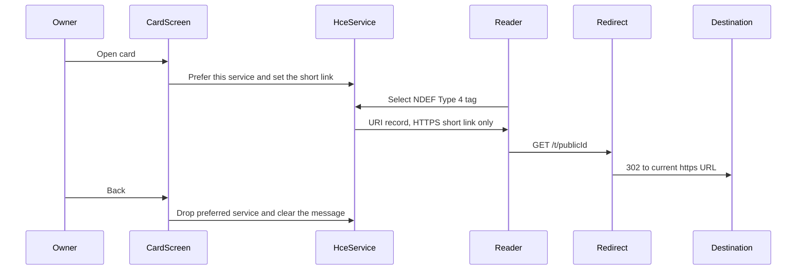

# Smart Tap technical architecture

Decisions below resolve the open points in [mvp-spec.md](mvp-spec.md) for the first build. In-app history is deferred. Soft-delete stays, so a deleted card can be restored and stops redirecting while it is in the trash.

## Stack

**Use Kotlin (Jetpack Compose) for Android, Next.js (TypeScript, App Router) for the web app and API, Clerk for sign-in, and Supabase for Postgres and image storage.**

- **Android is Kotlin.** Host card emulation is an Android `HostApduService`. A cross-platform UI toolkit would still drop into this same service, so the app that must not break Wallet stays native.
- **One Next.js app** serves the web editor, the JSON API the phone calls, and the public tap redirect. Web and Android share that API. The web app uses **pnpm**.
- **Clerk** is the account system from the first build. Google is the only sign-in method turned on. The same Clerk user is the link between web and phone. No pairing code. Clerk’s Android SDK holds the session; Next.js uses `@clerk/nextjs`. Organizations, extra login methods, and account recovery stay switched off until those features exist. Clerk is in from the start because every card row stores a Clerk user id, and the spec already points at team sharing and account recovery later. Swapping auth after that is a data migration.
- **Supabase** is the database and file store. Clerk is registered as a Supabase third-party auth provider (native integration, with the `role: authenticated` claim). Row level security uses `auth.jwt()->>'sub'`, which is the Clerk user id string. `cards.user_id` is `text`.
- **PostHog** is in from the first build, for the owner funnel. See Product analytics.
- **Deploy** the Next.js app on Vercel, with the tap route on the Node runtime talking to Supabase’s pooler. A tap adds one redirect hop, which is acceptable. Move that route to the edge only if real taps feel slow.

Two projects in the repo, no shared code: `android/` and `web/`. The phone displays a PNG. It does not run the designer.

## How a tap works

Every card has a stable public id. NFC and the on-screen QR both carry the same URL: `https://<host>/t/<publicId>`. The destination the owner edits lives in Postgres. Changing it takes effect on the next tap even if the phone has not synced.

NFC rules, owned in-tree (a small Type 4 NDEF state machine, AID `D2760000850101` only):

- Emulation is on only while the card screen is resumed. `CardEmulation.setPreferredService` on resume, `unsetPreferredService` on pause or back. The service refuses SELECT when no card is open, so a background or stale process cannot keep sharing.
- Register no payment AID. Wallet keeps payment routing when this screen is closed. That collision still has to be proven on a real terminal; the architecture only makes it possible.
- The NDEF message is one URI record, first in the message, so Android and iPhone background tag reading both look for the same record. iPhone reading of Android host-emulated tags is the flakiest part of this product. The large QR on the back of the card is the supported fallback, not a later idea.
- The card screen keeps the display on (`FLAG_KEEP_SCREEN_ON`).
- The emulator cannot do NFC. UI can be developed there. Tap, QR, and a Wallet payment afterward are physical-device tests.

The redirect (`GET /t/[publicId]`) looks up a non-deleted card and returns **302** with `Cache-Control: no-store`. Unknown or trashed ids get a short “this card is off” page. Our database stores no tap row. The redirect may emit one anonymous PostHog event, described below.

The card screen’s job is “make this short link available.” On Android that means host card emulation plus the QR.

## Product analytics

Add PostHog at the start. The success bar in the spec (a working card and a first tap within minutes, then actually reaching for the app) is invisible if those events begin later. There is still no history screen and no `tap_events` table.

Capture explicit events. Leave autocapture and session replay off, so destination URLs and card artwork stay out of recordings.

Owner events, identified by Clerk user id:

- `signed_in`
- `card_created`
- `card_opened` (owner opened the card screen)
- `destination_updated`
- `card_deleted` and `card_restored`
- `widget_added`

One server-side event, `tap_redirected`, fires on a successful 302. Properties are the card id and a coarse reader platform from the user-agent (iOS, Android, other). Set `$process_person_profile` to false so a recipient never becomes a PostHog person. This is how we see a first successful tap. It is an internal metric, and the app shows no tap history.

## Data model

`cards`

- `id`
- `user_id` — Clerk subject, `text`
- `title`
- `destination_url` — https only
- `public_id` — unguessable, never changes (this is what a future printed card would encode)
- `image_path` — PNG in storage, about 2024×1276, ratio 1.586:1 (85.6 × 53.98 mm)
- `design_json` — null when the artwork is an imported image
- `created_at`, `updated_at`, `deleted_at`

Row level security: `auth.jwt()->>'sub' = user_id`. Storage path `cards/{userId}/{cardId}.png` with the same rule. The redirect uses the service role and is the only public read.

No `tap_events` table in this build.

## Clients

**Sync.** The phone keeps cards in Room and refreshes from `GET /api/cards` on launch and when the app returns to the foreground. Images use the image loader’s disk cache, so the grid still opens without a network. Writes (destination, add, soft-delete, restore) go to the API immediately. One owner, one phone: last write wins.

**Android.** Home grid, full card screen, swipe to a QR back, quick edit (destination, add, delete), trash with restore, and a home-screen widget bound to one card. The widget’s click opens that card screen so emulation starts the same way. Add-on-phone sends title and destination; the server renders a default PNG. Sign-in uses the Clerk Android SDK. The API receives the Clerk session token.

**Card screen layout.** The phone stays portrait. The landscape card sits centered. That matches holding the phone out for a tap against the upper back, where the antenna usually is.

**Web.** Clerk Google sign-in, card list, trash, destination field, image import with a crop to the card ratio, and a small designer. The designer is a template: background color, name, subtitle, optional photo. Safe zones for chip, tap mark, and QR are guides on top of the art, kept out of the PNG. The browser previews the same SVG the server rasterizes on save, and the phone only ever downloads the PNG.

**API** (Clerk session token on Android, Clerk session on the web): list, create, update, soft-delete, restore. Image upload goes straight to Supabase Storage using that same Clerk token.

## Future iPhone app

A later iPhone app would be another client of this API: view cards, edit the destination, and share by QR. NFC emulation stays on Android. Details are in [future-ios.md](future-ios.md).

## Boundaries for this build

- No in-app history, tap counts, or edit log. Measurement lives in PostHog.
- No onboarding wizard, compatibility walkthrough, or offline tap story. A phone with no HCE feature simply cannot open sharing.
- No freeform canvas, PDF import, print export, or physical-card ordering. The stable `/t/<publicId>` link is the seam those features attach to later.
- No iOS app in this build.

## What to validate before calling the tap done

- Pixel-class Android taps another Android phone and the short link opens.
- The same card against a recent iPhone, and the QR path when that tap does not.
- After leaving the card screen, a Google Wallet payment still works.
- Editing the destination on the web changes the next tap without reopening the card on the phone.
- Soft-delete stops the redirect; restore brings the same URL back.
- A signed-in session on web and Android shows the same Clerk user, and a card created on one appears on the other.
- `card_created`, `card_opened`, and `tap_redirected` arrive in PostHog, and the tap event is not tied to a person profile.
